## Before Starting

Before writing any code, read the frontend design skill:

```
read /mnt/skills/public/frontend-design/SKILL.md
```

This is mandatory — do not skip this step.

---

## What is Sharpnr?

**Sharpnr** is a cloud-based platform for managing business operations across different industries.

## Sharpnr Features & Services

- Support for multiple legal entities, each with its own independent accounting books and financial records.
- Manage multiple industries and business sectors from a single platform, including mixed businesses such as hospitals, hotels, restaurants, retail stores, and more.
- Choose between separate accounting books for each legal entity or consolidated financial reporting across the organization.
- Modular architecture—use only the applications you need.
- Business Operation Apps can run completely independently without requiring other Sharp platform services.
- Sharp-Accounting can be deployed as a standalone accounting solution or integrated with Business Operation Apps for automatic transaction recording.
- Out-of-the-box integration across all Sharp applications for a seamless business workflow.
- Every application is provisioned and managed through **Orchestrator**, the central administration app.
- Multi-tenant, multi-company, and multi-branch architecture.
- Enterprise-grade security with role-based access control and audit logs.
- Designed for organizations of any size, from small businesses to large enterprises.
- Pay only for the applications and services you use _(pricing to be announced; currently free during the early access period)._

---

### 4-Layer Architecture

1. **Business Operation Layer** — Industry-specific apps (end-user/customer facing)
2. **Organization Control Layer** — Central hub where organizations manage and orchestrate all services
3. **Sharpnr Core Services** — Suite of business apps (CRM, HRMS, Accounting, Messaging, Storage, etc.)
4. **B2B Platform Layer** — Org-to-Org connections for trading goods, services, and communications

---

### Layer 1: Business Operation Layer

Industry-specific apps for end customers:

**Hospitality**

- Hotels, Restaurants, Bars, Night Clubs, Resorts
- Apps: Room reservations, Table management, KDS (Kitchen Display Systems)
- Sharpnr offering: **Sharp-Hospitality** (live)

**Medical/Healthcare**

- Hospitals, Clinics, Pharmacies, Nursing Centers
- Apps: Patient management, Appointment scheduling, Medical records
- Sharpnr offering: **Lifco** (coming soon)

---

### Layer 2: Organization Control Layer

Where organizations manage their entire Sharpnr ecosystem:

- Enable/disable services per company
- Configure industry-specific apps
- Control user access and permissions
- Orchestrate workflows across all services

---

### Layer 3: Sharpnr Core Services

Business management suite built into the platform:

- **CRM** — Customer relationship management
- **HRMS** — Human resources & payroll
- **Accounting** — Financial management & invoicing
- **Messaging & Communications** — Internal + external chat
- **Storage** — File management & backups
- **IT Controls** — Security, integrations, API management

---

### Layer 4: B2B Platform Layer

Organizations connect with other organizations:

- Trade goods and services
- Finalize deals and contracts
- Communicate via **Cables** (Sharpnr messaging app)
- Share accounting/billing data securely
- Manage inter-org workflows

---

### Multi-Company, Multi-Industry Example

```mermaid
flowchart LR
    Marketplace["🌐 Sharp-Marketplace\nOrg-to-Org O2O — B2B Layer"]

    subgraph Org1["🏢 Org A — Global Enterprises Inc."]
        direction TB

        subgraph BizOps1["📦 Business Operation Layer"]
            Hotel["🏨 Sharp-Hospitality"]
            Hospital["🏥 Sharp-Lifco"]
            Events["🎪 Custom Apps"]
        end

        OrgControl1["⚙️ Organization Control Layer\n(Orchestrator)"]

        subgraph CoreServices1["🔧 Sharpnr Core Services"]
            CRM1["💼 Sharp-CRM"]
            HRMS1["👥 Sharp-HR"]
            Acct1["💰 Sharp-Accounting"]
            Msg1["💬 Cables"]
            Storage1["💾 Silo"]
            Folio1["📄 Folio"]
            Cortex1["🔒 Cortex"]
        end

        OrgGateway1(["🔗 Org A Gateway"])

        BizOps1 --> OrgControl1
        OrgControl1 --> CoreServices1
        CoreServices1 --> OrgGateway1
    end

    subgraph Org2["🏢 Org B — Tech Solutions Ltd."]
        direction TB

        subgraph BizOps2["📦 Business Operation Layer"]
            SaaS["💻 Sharp-Tech"]
            Retail["🛍️ Sharp-Retail"]
            Support["🎧 Support Ops"]
        end

        OrgControl2["⚙️ Organization Control Layer\n(Orchestrator)"]

        subgraph CoreServices2["🔧 Sharpnr Core Services"]
            CRM2["💼 Sharp-CRM"]
            HRMS2["👥 Sharp-HR"]
            Acct2["💰 Sharp-Accounting"]
            Msg2["💬 Cables"]
            Storage2["💾 Silo"]
            Folio2["📄 Folio"]
            Cortex2["🔒 Cortex"]
        end

        OrgGateway2(["🔗 Org B Gateway"])

        BizOps2 --> OrgControl2
        OrgControl2 --> CoreServices2
        CoreServices2 --> OrgGateway2
    end

    subgraph Org3["🏢 Org C — Finance Only Corp."]
        direction TB

        OrgControl3["⚙️ Organization Control Layer\n(Orchestrator)"]

        subgraph CoreServices3["🔧 Sharpnr Core Services"]
            CRM3["💼 Sharp-CRM"]
            HRMS3["👥 Sharp-HR"]
            Acct3["💰 Sharp-Accounting"]
            Msg3["💬 Cables"]
            Storage3["💾 Silo"]
        end

        OrgGateway3(["🔗 Org C Gateway"])

        OrgControl3 --> CoreServices3
        CoreServices3 --> OrgGateway3
    end

    OrgGateway1 --> Marketplace
    OrgGateway2 --> Marketplace
    OrgGateway3 --> Marketplace

    style Marketplace fill:#1a1a2e,color:#ffffff,stroke:#00d4ff,stroke-width:3px
    style OrgGateway1 fill:#00d4ff,color:#000000,stroke:#00d4ff,stroke-width:2px
    style OrgGateway2 fill:#00d4ff,color:#000000,stroke:#00d4ff,stroke-width:2px
    style OrgGateway3 fill:#00d4ff,color:#000000,stroke:#00d4ff,stroke-width:2px
    style OrgControl1 fill:#2d1b69,color:#ffffff,stroke:#9b59b6,stroke-width:2px
    style OrgControl2 fill:#2d1b69,color:#ffffff,stroke:#9b59b6,stroke-width:2px
    style OrgControl3 fill:#2d1b69,color:#ffffff,stroke:#9b59b6,stroke-width:2px
    style Org1 fill:#0d1117,color:#ffffff,stroke:#30a14e,stroke-width:2px
    style Org2 fill:#0d1117,color:#ffffff,stroke:#30a14e,stroke-width:2px
    style Org3 fill:#0d1117,color:#ffffff,stroke:#ff9900,stroke-width:2px
    style BizOps1 fill:#0d2137,color:#ffffff,stroke:#00aaff,stroke-width:1px
    style BizOps2 fill:#0d2137,color:#ffffff,stroke:#00aaff,stroke-width:1px
    style CoreServices1 fill:#1a0d2e,color:#ffffff,stroke:#9b59b6,stroke-width:1px
    style CoreServices2 fill:#1a0d2e,color:#ffffff,stroke:#9b59b6,stroke-width:1px
    style CoreServices3 fill:#1a0d2e,color:#ffffff,stroke:#9b59b6,stroke-width:1px
    style Hotel fill:#0d2137,color:#ffffff
    style Hospital fill:#0d2137,color:#ffffff
    style Events fill:#0d2137,color:#ffffff
    style SaaS fill:#0d2137,color:#ffffff
    style Retail fill:#0d2137,color:#ffffff
    style Support fill:#0d2137,color:#ffffff
    style CRM1 fill:#1a0d2e,color:#ffffff
    style HRMS1 fill:#1a0d2e,color:#ffffff
    style Acct1 fill:#1a0d2e,color:#ffffff
    style Msg1 fill:#1a0d2e,color:#ffffff
    style Storage1 fill:#1a0d2e,color:#ffffff
    style Folio1 fill:#1a0d2e,color:#ffffff
    style Cortex1 fill:#1a0d2e,color:#ffffff
    style CRM2 fill:#1a0d2e,color:#ffffff
    style HRMS2 fill:#1a0d2e,color:#ffffff
    style Acct2 fill:#1a0d2e,color:#ffffff
    style Msg2 fill:#1a0d2e,color:#ffffff
    style Storage2 fill:#1a0d2e,color:#ffffff
    style Folio2 fill:#1a0d2e,color:#ffffff
    style Cortex2 fill:#1a0d2e,color:#ffffff
    style CRM3 fill:#1a0d2e,color:#ffffff
    style HRMS3 fill:#1a0d2e,color:#ffffff
    style Acct3 fill:#1a0d2e,color:#ffffff
    style Msg3 fill:#1a0d2e,color:#ffffff
    style Storage3 fill:#1a0d2e,color:#ffffff
```



## Sharpnr Services Apps (Layer 3)

### Cables

- Secure messaging, voice calls, and video conferencing.
- One-to-one chats, group chats, and organization-wide channels.
- Threaded conversations with rich media and file sharing.
- Fast, encrypted, and low-latency communication platform.
- Deep context integration across all Sharp applications and workflows.
- Share records, documents, invoices, tickets, and tasks directly within conversations.
- Cross-organization collaboration with external partners and vendors.
- Customer communication without requiring a Sharp account.
- Temporary guest links for customers and external participants.
- Real-time notifications and presence indicators.
- Screen sharing and meeting collaboration tools.
- Message search, history, and conversation archives.
- AI-powered conversation summaries and smart search.
- Role-based access control and enterprise-grade security.
- Unified communication layer connecting every service in the Sharp ecosystem.

### Silo

A unified storage platform for structured, semi-structured, and unstructured data, designed to serve as the central data foundation for all Sharp applications.

- Object Storage
- Structured Data Storage (RDBMS)
- Unstructured File Storage
- Data Lake
- Data Warehouse
- Lakehouse Architecture
- API-first Data Access
- High-performance Data Ingestion
- Data Sharing Across Applications
- Machine Learning & AI Data Storage
- Metadata & Schema Management
- Backup & Replication
- Encryption & Access Control
- Scalable Distributed Storage
- Analytics-ready Data Platform

### Sharp-Accounting

- Built on **Double Accrual Accounting** principles out of the box.
- Support for additional accounting methodologies coming soon.
- Automatic journal entries from business applications like **Sharp-Hospitality**, eliminating manual ledger recording.
- General Ledger Management
- Accounts Payable (AP)
- Accounts Receivable (AR)
- Automatic Purchase-to-Inventory Accounting
- Inventory Valuation & Cost Tracking
- Smart Entry for invoices, receipts, and journal entries.
- Bank Reconciliation
- Cash Flow Management
- Budgeting & Financial Planning
- Fixed Asset & Depreciation Management
- Expense & Reimbursement Management
- Multi-Currency Support
- Multi-Company & Multi-Legal Entity Support
- Parent, Child, and Subsidiary Entity Relationships
- Consolidated Financial Statements
- Tax Calculation & Filing
- Financial Compliance & Audit Trails
- Role-Based Approval Workflows
- Recurring Transactions & Scheduled Entries
- Financial Dashboards & Analytics
- Balance Sheet
- Profit & Loss Statement
- Cash Flow Statement
- Trial Balance
- General Ledger Reports
- Custom Financial Reports
- API-first Integration with the Sharp Platform
- Does Not matter your Industry or Sector works and Integrate seemlesly

### Sharp-Marketing

- Customer Relationship Management (CRM)
- Lead Management
- Contact Management
- Account Management
- Opportunity & Pipeline Management
- Customer Acquisition
- Marketing Automation
- Email Marketing
- SMS & WhatsApp Campaigns
- Social Media Campaign Management
- Form Builder
- Lead Capture & Lead Scoring
- Customer Segmentation
- Campaign Management
- Customer Journey Automation
- Sales Funnel Management
- Deal Tracking
- Activity Timeline
- Task & Follow-up Management
- Meeting & Call Scheduling
- Customer Support Integration
- Feedback Management
- Surveys & Polls
- Loyalty & Rewards Programs
- Referral Program Management
- Customer Engagement Tracking
- Analytics & Reporting
- Conversion Tracking
- ROI Analytics
- Attribution Tracking
- Dashboard & KPIs
- Third-party Integrations
- Notification Management
- Document & Proposal Management
- Customer Portal
- Soon to Renamed Sharp-CRM

### Folio

Create, collaborate, and organize your knowledge in one place.
Folio is the productivity suite for the Sharp platform, bringing documents, spreadsheets, presentations, notes, whiteboards, and PDFs together with seamless real-time collaboration.

- Documents
- Spreadsheets
- Presentations (Slides)
- PDF Viewing & Annotation
- Whiteboards
- Markdown Editor
- Notes & Knowledge Base
- Real-time Collaboration
- Comments & Version History
- Rich Media Embedding
- Tight Integration Across the Sharp Platform
- Shareable Workspaces & Permissions
- API-first Architecture

### Cortex

Centralized IT administration and access management for the Sharp platform. Cortex enables IT teams to securely manage infrastructure, users, devices, permissions, and organizational resources from a single control plane.

- Role-Based Access Control (RBAC)
- Silo Database Access Management (Read, Write, Admin)
- Resource Permission Management
- API Key & Service Account Management
- Audit Logs & Activity Tracking
- Security Policies & Compliance
- Multi-Organization Administration
- Secret & Credential Management
- Infrastructure Access Control
- Device Management _(Coming Soon)_
- Endpoint Security _(Coming Soon)_
- Asset Inventory _(Coming Soon)_
- Policy Enforcement & Approval Workflows _(Coming Soon)_
- Centralized Administration Across the Sharp Platform

### Sharp-HR

A comprehensive Human Resource Management System (HRMS) for managing employees, payroll, attendance, recruitment, and workforce operations from a single platform.

- Employee Information Management
- Recruitment & Hiring
- Employee Onboarding & Offboarding
- Payroll Management
- Attendance & Time Tracking
- Leave & Holiday Management
- Shift & Roster Scheduling
- Performance Reviews & Appraisals
- Goals & OKR Tracking
- Employee Self-Service Portal
- Expense Claims & Reimbursements
- Complaints & Grievance Management
- Asset Assignment & Tracking
- Training & Learning Management
- Documents & Compliance Management
- Organization Chart & Directory
- Announcements & Internal Communication
- Benefits & Compensation Management
- Multi-Company & Multi-Branch Support
- HR Analytics & Reports
- Role-Based Access Control

### SharpIAM

A self-service employee portal that enables employees and managers to access company resources, manage teams, complete daily tasks, and stay connected with the organization from anywhere.

- Secure Employee Login
- Employee Dashboard
- Team Management
- Organization Directory
- View & Manage Assigned Tasks
- Leave Applications & Approval Tracking
- Expense & Reimbursement Requests
- Payroll & Payslip Access
- Attendance & Timesheets
- Performance Reviews & Goals
- Activity Logs & Work History
- Company Announcements
- Document Access & Downloads
- Profile & Personal Information Management
- Shift & Schedule Viewing
- Holiday Calendar
- Manager Approvals
- Reports & Analytics
- Notifications & Reminders
- Integrated with the Entire Sharp Platform

### Orchestrator

The administration application for the Sharp platform. Orchestrator provides a unified interface for platform administrators to monitor, control, configure, and orchestrate every Sharp service and application from a single dashboard.

- Platform Administration Dashboard
- Start, Stop, and Restart Sharp Services
- Enable or Disable Platform Applications
- Service Health & Status Monitoring
- View Logs & Diagnostics
- Platform Configuration Management
- Workflow & Automation Management
- Resource Usage Monitoring
- User Session Management
- API & Integration Management
- Platform Alerts & Notifications
- Maintenance Mode Controls
- Audit Logs & Administrative Activity
- Role-Based Administrative Access
- Central Command Center for the Entire Sharp Platform
- Stake Holder can view Whole Organization.

---

## Business Operations Apps (Layer 1)

Sharp Business Operations Apps are industry-specific solutions designed to manage day-to-day operations while integrating seamlessly with the rest of the Sharp platform.

### Sharp-Hospitality

An all-in-one platform for hotels, restaurants, cafés, bars, resorts, and hospitality businesses, providing unified operations, accounting integration, inventory management, and multi-property management.

- Restaurant & Hotel Management
- Point of Sale (POS)
- Table Management
- Takeaway & Delivery Orders
- Hotel Room Reservations
- Restaurant Table Reservations
- Guest Check-in & Check-out
- Room Service Management
- Kitchen Order Management (KDS)
- Digital Menu & QR Ordering
- Highly Configurable Workflows
- Multi-Branch & Multi-Property Support
- Multi-Legal Entity Support
- Shared Kitchen Across Multiple Businesses
- Shared Menu Across Multiple Businesses
- Route Menu Items to Different Kitchens
- Inventory & Stock Management
- Purchase & Supplier Management(Sharp-Accounting or Independently)
- Automatic Accounting Integration with Sharp-Accounting
- Staff & Shift Management
- Customer Loyalty & Membership Programs(through Sharp-Marketing)
- Reports & Business Analytics
- Works seamlessly with the Sharp ecosystem out of the box, or can be used independently

### Lifco _(Coming Soon)_

A comprehensive healthcare management platform for hospitals, clinics, diagnostic centers, pharmacies, and healthcare providers.

- Patient Management & Medical Records
- Appointment Scheduling
- Doctor & Staff Management
- Pharmacy & Inventory Management
- Billing & Insurance Integration
- Multi-Branch Support
- Integrated with Sharp-Accounting and Sharp-Platform
- Ever expanding features

## Sharp Platform Apps(layer 4)

### Sharp-Marketplace

A B2B marketplace exclusively for organizations on the Sharp platform, enabling businesses to buy and sell products and services through a trusted and verified network.

- Buy and sell goods and services with other organizations
- Verified suppliers and service providers
- Discover new business partners and procurement opportunities
- Cross-industry marketplace (e.g., furniture suppliers serving hotels, hospitals, offices, and more)
- Request for Quotation (RFQ) and vendor comparison
- Organization-to-organization transactions only
- Integrated with Sharp-Accounting and Business Operations Apps
- Secure business identity verification
- Procurement and supplier management
- Seamless integration with the Sharp platform
- Send quotations directly from Sharp-Marketing (CRM) to Cables or the recipient's preferred communication channel
- Create purchase orders and invoices directly from marketplace transactions
- One-click onboarding with automatic organization verification
- Hassle-free product and service publishing with no catalog management required
- AI-powered supplier discovery and recommendations
- Unified procurement workflow across the Sharp ecosystem
- No Commision and Charges

---

---

## Project Setup

We use React + Vite + TypeScript.

- TypeScript config: [tsconfig.app.json](/tsconfig.app.json), [tsconfig.json](/tsconfig.json), [tsconfig.node.json](/tsconfig.node.json)
- Vite config: [vite.config.ts](/vite.config.ts)
- All dependencies: [package.json](/package.json)

---

## Routing

We use **TanStack Router** with **file-based routing**.

- All route files live in [src/routes](/src/routes/)
- Routes are auto-generated based on file names (no manual route registration)
- The root layout is in [src/routes/\_\_root.tsx](/src/routes/__root.tsx)
- Use `<Link>` from `@tanstack/react-router` for internal navigation — never `<a href>` for internal links
- For external links use `<a href target="_blank" rel="noopener noreferrer">` or `window.location.replace()`
- Use `useNavigate` for programmatic navigation
- Route params are typed automatically via TanStack Router's codegen

```
routes/
├── __root.tsx          ← root layout (header, footer, outlet)
├── index.tsx           ← / (Landing)
├── products.tsx        ← /products
├── services.tsx        ← /services
├── industries.tsx      ← /industries
└── about.tsx           ← /about
```

---

## Folder Structure

All sections and components live in [src/app](/src/app/) and are imported into the routes folder.

- Each page has its own folder inside `src/app/`
- Each section has its own component file
- Animations for each section live in an `animations/` subfolder inside that section
- GSAP is pre-configured with all plugins registered — import from [src/configs/gsap.tsx](/src/configs/gsap.tsx)

### Current State of the Project

The project is currently a **clean skeleton** — all previous code has been removed.
Only basic structure exists:

- Route files exist with empty or basic `<div>` components
- `__root.tsx` has the basic layout shell (Header, Footer placeholders)
- `src/app/` folders exist but components are empty or not yet created
- GSAP is configured in `src/configs/gsap.tsx`
- `src/configs/env.ts` is set up with all external URLs

**Start fresh from scratch** — do not assume any existing implementation.
Build every section, component, and animation from the ground up based on this document.
if some component remains remove it rewrite,

```
➜ src
    ➜ ai
        ➜ ai.ts
        ➜ AIChat.tsx
        ➜ AIQuestionReel.tsx
        ➜ sharpnr_context.ts
    ➜ app
        ➜ about
            ➜ animation
        ➜ footer
            ➜ animation
            ➜ Footer.tsx
        ➜ header
            ➜ animations
            ➜ Header.tsx
            ➜ MobileMenu.tsx
        ➜ index
            ➜ hero
                ➜ animations
                ➜ HeroSection.tsx
        ➜ industries
            ➜ animations
            ➜ IndustriesHeroSection.tsx
        ➜ products
            ➜ animation
            ➜ ProductsHeroSection.tsx
        ➜ services
    ➜ configs
        ➜ env.ts
        ➜ gsap.tsx
    ➜ hooks
        ➜ useDevice.ts
    ➜ lib
        ➜ utils.ts
    ➜ routes
        ➜ __root.tsx
        ➜ about.tsx
        ➜ index.tsx
        ➜ industries.tsx
        ➜ products.tsx
        ➜ services.tsx
    ➜ index.css
    ➜ main.tsx
    ➜ routeTree.gen.ts
    ➜ vite-env.d.ts
```

### Folder Rules

- Every new section goes inside its page folder in `src/app/`
- Every new animation goes inside the `animations/` subfolder of that section
- Never put section components directly in `src/routes/` — routes only import from `src/app/`
- Always import GSAP from `src/configs/gsap.tsx` — never import directly from `gsap`

### Route File Convention

Every route file follows this exact pattern — import sections from `src/app/`, define `head()` for SEO meta tags, and compose the page in the component function.

**Example: [src/routes/index.tsx](/src/routes/index.tsx)**

```tsx
import { HeroSection } from "@/app/index/hero/HeroSection";
import { createFileRoute } from "@tanstack/react-router";

export const Route = createFileRoute("/")({
  component: RootComponent,
  head: () => ({
    meta: [
      { title: "Sharpnr | Page Title Here" },
      { name: "description", content: "Page description here." },
      { name: "keywords", content: "relevant, keywords, here" },
      { property: "og:title", content: "Sharpnr | Page Title Here" },
      { property: "og:description", content: "OG description here." },
      { property: "og:type", content: "website" },
      { property: "og:url", content: "https://sharpnr.com/page" },
      { name: "twitter:card", content: "summary_large_image" },
    ],
  }),
});

function RootComponent() {
  return (
    <div>
      <HeroSection />
      {/* Add more sections here */}
    </div>
  );
}
```

### Route File Rules

- Every route **must** have a `head()` with full SEO meta tags — title, description, keywords, og tags, twitter card
- Import all sections from `src/app/<pagename>/` — never write section code inside route files
- The component function only composes sections — no logic, no state, no hooks in route files
- `og:url` must match the actual page URL

## External Links & Config

All external links to Sharpnr platform applications are defined in [src/configs/env.ts](/src/configs/env.ts).

- Always import `config` from `@/configs/env` — never hardcode any URL
- Use `<Link>` from TanStack Router for internal pages only
- Use `<a href>` or `window.location` for all external app URLs

### Key URLs

| Use Case                            | Config Key                      |
| ----------------------------------- | ------------------------------- |
| Login button                        | `config.authAppUrl`             |
| Get Started / Sign Up CTA           | `config.authAppUrl + "/signup"` |
| Cables (Messaging & Communications) | `config.cablesAppUrl`           |
| Silo (Storage & Data Platform)      | `config.siloAppUrl`             |
| Folio (Docs, Sheets, Whiteboards)   | `config.folioAppUrl`            |
| Cortex (IT Controls & Access)       | `config.cortexAppUrl`           |
| Orchestrator (Command Center)       | `config.orchestratorAppUrl`     |
| Sharp-Accounting (Finance)          | `config.accountingAppUrl`       |
| Sharp-CRM / Sharp-Marketing (CRM)   | `config.marketingAppUrl`        |
| Sharp-HR (HRMS & Payroll)           | `config.hrAppUrl`               |
| SharpIAM (Employee Portal)          | `config.iamAppUrl`              |
| Sharp-Hospitality (Business Ops)    | `config.hospitalityAppUrl`      |
| Sharp-Marketplace (B2B / O2O)       | `config.marketplaceAppUrl`      |

## Website Pages

| Page           | Route         | Purpose            | Key Sections                                                                |
| -------------- | ------------- | ------------------ | --------------------------------------------------------------------------- |
| **Landing**    | `/`           | First impression   | Hero, 4-layer architecture, key apps, CTA, sharpnr features                 |
| **Products**   | `/products`   | All Sharpnr apps   | Cards for each Core Services app                                            |
| **Services**   | `/services`   | Industry solutions | Sharp-Hospitality, Lifco and more industries comming, retails, Manfucturing |
| **Industries** | `/industries` | Sectors we serve   | Hospitality, Healthcare, expanding                                          |
| **About**      | `/about`      | Company story      | Mission, vision, what we're building                                        |

---

## Brand Assets & Logos

All brand assets are stored in [public](/public/).

| Asset                    | File                             | Usage                  |
| ------------------------ | -------------------------------- | ---------------------- |
| Sharpnr Logo (Full)      | `/public/sharpnr-logo.svg`       | Header, Footer         |
| Sharpnr Logo (Icon only) | `/public/sharpnr-icon.svg`       | Favicon, mobile header |
| Sharpnr Logo (White)     | `/public/sharpnr-logo-white.svg` | Dark backgrounds       |
| Sharpnr Logo (Dark)      | `/public/sharpnr-logo.svg`       | Light backgrounds      |

### Logo Rules

- Always use SVG — never PNG or JPG for logos
- Never stretch, rotate, or recolor the logo
- On dark backgrounds → use white version `/public/sharpnr-logo-white.svg`
- On light backgrounds → use full logo `/public/sharpnr-logo.svg`
- In React reference public files directly — never import from public folder
- Minimum logo width: `120px`

### Usage in React

\```tsx
// ✅ Correct — reference public files directly


// ❌ Wrong — never import from public
import logo from "/public/sharpnr-logo.svg";
\```

---

## Social Media Links

All social links are hardcoded constants — they are public URLs, not env variables.

| Platform        | URL                                    | Where Used |
| --------------- | -------------------------------------- | ---------- |
| **LinkedIn**    | `https://linkedin.com/company/sharpnr` | Footer     |
| **X / Twitter** | `https://x.com/sharpnr`                | Footer     |
| **Instagram**   | `https://instagram.com/sharpnr`        | Footer     |
| **YouTube**     | `https://youtube.com/@sharpnr`         | Footer     |

### Social Links Rules

- Open all social links in a new tab — `target="_blank" rel="noopener noreferrer"`
- Use `<a href>` — never `<Link>` for social links
- Social icons should use SVG icons from `src/assets/icons/social/`
- All social links go in the **Footer only** — not in the header

---

## Content Rules

- No fake testimonials — we don't have customers yet
- No fake stats or counter sections — we are in alpha phase
- Always use this document to create content — never make up features or descriptions
- Sharpnr is a cloud-based SaaS platform — never use words like "deploy", "self-hosted", "install", "live server"
- Never say "Buy" or "Purchase" — use "Get Started" or "Subscribe"
- Never mention pricing — pricing is not finalized, we are free during early access
- Do not add a pricing page or pricing section anywhere
- No waitlist or newsletter forms — no backend yet
- Do not shorten or oversimplify app descriptions — use the details provided in this document
- When writing CTAs use: "Get Started", "Learn More", "Contact Us" — nothing else
- Sharpnr is in **Alpha** — never describe it as "production ready" or "enterprise ready" even though it is built for enterprises
- All content must be factual and based only on what is written in this CLAUDE.md
- If a feature or detail is not mentioned in this document — do not invent it, ask instead, you can write it more professional language

## Terminology — Use These Words

| ✅ Use               | ❌ Never Use                                             |
| -------------------- | -------------------------------------------------------- |
| Cloud-based SaaS     | Deployable, Self-hosted                                  |
| Get Started          | Buy, Purchase                                            |
| Early Access / Alpha | Live, Beta, Launched                                     |
| Organization         | Company (when referring to Sharpnr clients)              |
| Subscribe            | Pay, Checkout                                            |
| Platform             | Software, Tool, App (when describing Sharpnr as a whole) |

---

## Do Not

### Code

- Do not use class components — functional components only
- Do not write custom CSS or inline styles — Tailwind only
- Do not hardcode any external URLs — always use `config` from `@/configs/env`
- Do not use `<a href>` for internal navigation — use `<Link>` from TanStack Router
- Do not modify auto-generated files — especially `routeTree.gen.ts`
- Do not install new packages without asking
- Do not put logic inside `main.tsx`

### Content

- Do not use fake data, stats, testimonials, or counters anywhere
- Do not invent features or descriptions not mentioned in this document
- Do not add pricing, waitlist, or newsletter sections
- Do not use wrong terminology — refer to the Terminology table

### Structure

- Do not add pages beyond the 5 routes (`/`, `/products`, `/services`, `/industries`, `/about`)
- Do not change the folder structure without asking
- Do not rename or delete existing components without asking
- Do not split `__root.tsx` — Header and Footer stay in the root layout
- Do Not add logic route files live in [src/routes](/src/routes/) use app folder

---

## Animations & Effects

We use **GSAP** for all animations. GSAP is pre-configured with all plugins registered in [src/configs/gsap.tsx](/src/configs/gsap.tsx) — always import from there, never directly from `gsap`.

```tsx
// ✅ Correct
import { gsap } from "@/configs/gsap";

// ❌ Never do this
import { gsap } from "gsap";
```

---

### Rules

- Always use `useGSAP()` hook — never use `useEffect()` for GSAP animations
- Always create a dedicated animation hook for each section — never write animations inline in the component
- Animation hooks live in the `animations/` folder inside the section folder
- If an animation is long or complex — break it into phases (see phases guide below)
- Always clean up animations — `useGSAP()` handles cleanup automatically
- Use `refs` to target elements — never use class or id selectors like `gsap.to(".hero-title")`
- Always respect `prefers-reduced-motion` for accessibility

---

### Folder Convention

```
src/app/
└── index/
    └── hero/
        ├── animations/
        │   └── useHeroAnimation.ts    ← animation hook
        └── HeroSection.tsx            ← component (imports the hook)
```

---

### Animation Hook Structure

Every animation hook follows this exact pattern:

```tsx
// src/app/index/hero/animations/useHeroAnimation.ts

import { useGSAP } from "@gsap/react";
import { gsap } from "@/configs/gsap";
import { RefObject } from "react";

interface HeroAnimationRefs {
  containerRef: RefObject<HTMLDivElement>;
  titleRef: RefObject<HTMLHeadingElement>;
  subtitleRef: RefObject<HTMLParagraphElement>;
  ctaRef: RefObject<HTMLDivElement>;
}

export function useHeroAnimation(refs: HeroAnimationRefs) {
  const { containerRef, titleRef, subtitleRef, ctaRef } = refs;

  useGSAP(
    () => {
      // Respect reduced motion
      const prefersReducedMotion = window.matchMedia(
        "(prefers-reduced-motion: reduce)",
      ).matches;
      if (prefersReducedMotion) return;

      const tl = gsap.timeline({ defaults: { ease: "power3.out" } });

      // Phase 1: Container entrance
      tl.from(containerRef.current, {
        opacity: 0,
        duration: 0.6,
      })

        // Phase 2: Title entrance
        .from(
          titleRef.current,
          {
            opacity: 0,
            y: 40,
            duration: 0.8,
          },
          "-=0.3",
        )

        // Phase 3: Subtitle entrance
        .from(
          subtitleRef.current,
          {
            opacity: 0,
            y: 20,
            duration: 0.6,
          },
          "-=0.4",
        )

        // Phase 4: CTA entrance
        .from(
          ctaRef.current,
          {
            opacity: 0,
            y: 20,
            duration: 0.5,
          },
          "-=0.3",
        );
    },
    { scope: containerRef },
  );
}
```

---

### Component Structure (using the hook)

```tsx
// src/app/index/hero/HeroSection.tsx

import { useRef } from "react";
import { useHeroAnimation } from "./animations/useHeroAnimation";

export function HeroSection() {
  const containerRef = useRef<HTMLDivElement>(null);
  const titleRef = useRef<HTMLHeadingElement>(null);
  const subtitleRef = useRef<HTMLParagraphElement>(null);
  const ctaRef = useRef<HTMLDivElement>(null);

  useHeroAnimation({ containerRef, titleRef, subtitleRef, ctaRef });

  return (
    <div ref={containerRef}>
      <h1 ref={titleRef}>...</h1>
      <p ref={subtitleRef}>...</p>
      <div ref={ctaRef}>...</div>
    </div>
  );
}
```

---

### Phases Guide (for complex animations)

Break long animations into clearly named phases using timeline labels:

```tsx
const tl = gsap.timeline({ defaults: { ease: "power3.out" } });

// ── Phase 1: Page entrance ─────────────────────────────
tl.from(containerRef.current, { opacity: 0, duration: 0.5 });

// ── Phase 2: Content reveal ────────────────────────────
tl.from(titleRef.current, { opacity: 0, y: 40, duration: 0.8 }, "-=0.2").from(
  subtitleRef.current,
  { opacity: 0, y: 20, duration: 0.6 },
  "-=0.4",
);

// ── Phase 3: Interactive elements ─────────────────────
tl.from(ctaRef.current, { opacity: 0, y: 20, duration: 0.5 }, "-=0.3").from(
  badgeRef.current,
  { opacity: 0, scale: 0.8, duration: 0.4 },
  "-=0.2",
);

// ── Phase 4: Ambient / loop animations ────────────────
tl.to(glowRef.current, {
  opacity: 0.6,
  repeat: -1,
  yoyo: true,
  duration: 2,
  ease: "sine.inOut",
});
```

---

### ScrollTrigger Animations

For scroll-based animations use `ScrollTrigger`:

```tsx
import { useGSAP } from "@gsap/react";
import { gsap } from "@/configs/gsap";
import { ScrollTrigger } from "gsap/ScrollTrigger";
import { RefObject } from "react";

export function useFeatureAnimation(containerRef: RefObject<HTMLDivElement>) {
  useGSAP(
    () => {
      gsap.from(containerRef.current, {
        opacity: 0,
        y: 60,
        duration: 0.8,
        ease: "power3.out",
        scrollTrigger: {
          trigger: containerRef.current,
          start: "top 80%",
          end: "top 40%",
          toggleActions: "play none none reverse",
        },
      });
    },
    { scope: containerRef },
  );
}
```

---

### Hover Animations

For hover effects use `useGSAP` with event listeners:

```tsx
export function useCardHoverAnimation(cardRef: RefObject<HTMLDivElement>) {
  useGSAP(
    () => {
      const card = cardRef.current;
      if (!card) return;

      const enterAnim = () =>
        gsap.to(card, {
          y: -8,
          scale: 1.02,
          duration: 0.3,
          ease: "power2.out",
        });
      const leaveAnim = () =>
        gsap.to(card, { y: 0, scale: 1, duration: 0.3, ease: "power2.inOut" });

      card.addEventListener("mouseenter", enterAnim);
      card.addEventListener("mouseleave", leaveAnim);

      return () => {
        card.removeEventListener("mouseenter", enterAnim);
        card.removeEventListener("mouseleave", leaveAnim);
      };
    },
    { scope: cardRef },
  );
}
```

---

### Naming Conventions

| Type                   | Naming Pattern                   | Example                        |
| ---------------------- | -------------------------------- | ------------------------------ |
| Animation hook         | `use[Section]Animation.ts`       | `useHeroAnimation.ts`          |
| Scroll animation hook  | `use[Section]ScrollAnimation.ts` | `useFeatureScrollAnimation.ts` |
| Hover animation hook   | `use[Element]HoverAnimation.ts`  | `useCardHoverAnimation.ts`     |
| Timeline phase comment | `── Phase N: Description ──`     | `── Phase 1: Entrance ──`      |

---

### Do Not

- Do not use `useEffect` for GSAP animations — always `useGSAP`
- Do not import GSAP directly — always from `@/configs/gsap`
- Do not write animations inline in components — always a dedicated hook
- Do not use string selectors — always `ref.current`
- Do not forget `prefers-reduced-motion` check for entrance animations
- Do not create animations without phases if the timeline has more than 3 steps

## Styling

We use **Tailwind CSS v4** — utility classes only, no custom CSS files, no inline styles. Only if it need for gsap animation

## Colors

We use **OKLCH** for all colors — never HEX or RGB.

### Color Rules

- Background is always **off-white** — never pure white `oklch(1 0 0)`
- use can use the color from [index.css](/src/index.css) read it may be Improve it

---

## Header

### Navigation Links

| Label         | Type     | Destination                                                                     |
| ------------- | -------- | ------------------------------------------------------------------------------- |
| Products      | Internal | `<Link to="/products">`                                                         |
| Services      | Internal | `<Link to="/services">`                                                         |
| Industries    | Internal | `<Link to="/industries">`                                                       |
| About         | Internal | `<Link to="/about">`                                                            |
| Docs & Guides | External | `<a href="https://docs.sharpnr.com" target="_blank" rel="noopener noreferrer">` |

### Header Buttons

| Button      | Type     | Destination                                |
| ----------- | -------- | ------------------------------------------ |
| Login       | External | `<a href={config.authAppUrl}>`             |
| Get Started | External | `<a href={config.authAppUrl + "/signup"}>` |

### Header Rules

- Logo on the left — links in the center — buttons on the right
- Login is a ghost button — Get Started is a primary button
- On mobile: hamburger menu — all nav links in `MobileMenu.tsx`
- Docs & Guides opens in a new tab — all other external links too
- Active route should be highlighted in nav using TanStack Router's `<Link>` active state

## Guides and Suggestions for Creating website

- use Visuals to Explain Sharpnr Platform Architecture and Platform
- use Gsap for visulization and animations use Flow animations Motion Graphics Style
- Mobiles first approch

### Scroll & UX

- `ScrollSmoother` is already set up in [src/routes/\_\_root.tsx](/src/routes/__root.tsx) — do not remove or modify it
- Add `ScrollTrigger` animations to sections as users scroll down
- Every section should animate in on scroll — nothing should be static on page load

### Design

- Be creative — make it look awesome and amazing
- Design references/screenshots will be provided separately during the session
- The website should feel premium and polished — this is an enterprise SaaS platform

## Investor Considerations

This website will be viewed by potential investors — it must convey trust, credibility, and vision.

#### Content Tone

- Use confident, professional language — never casual or informal
- Focus on the **scale and vision** of the platform — not just features
- Emphasize **breadth** — multi-industry, multi-company, multi-country ready
- Highlight **modularity** — organizations only pay for what they use
- Use words like "enterprise-grade", "unified", "scalable", "modular" — sparingly and accurately

#### Trust Signals to Include

- "Early Access" badge — shows traction without overpromising
- "Built for enterprises of any size" — signals scalability
- Clear platform architecture visualization — shows technical depth
- List of industries served — shows market breadth
- "Alpha" phase framing — honest but forward-looking

#### Visual Impression

- The website must look **premium and polished** — first impressions matter
- Every section must be pixel-perfect — no rough edges, no placeholder content
- Typography hierarchy must be strong — investors read headlines first
- Whitespace is credibility — never cram content
- The architecture diagram must be impressive — it is the core of the pitch

#### What to Avoid

- No fake metrics or traction numbers
- No spelling or grammar mistakes — proofread everything
- No generic stock-photo style illustrations

## Design Inspiration

These websites are references for the overall feel, quality, and design direction.
Do not copy — use as inspiration for layout, typography, spacing, and visual quality.

| Website                              | What to Take From It                                          |
| ------------------------------------ | ------------------------------------------------------------- |
| [Cloudflare](https://cloudflare.com) | Clean enterprise layout, strong typography, trust signals     |
| [Linear](https://linear.app)         | Minimal design, smooth animations, premium feel               |
| [Vercel](https://vercel.com)         | Typography hierarchy, whitespace, clean minimal SaaS layout   |
| [Stripe](https://stripe.com)         | Enterprise credibility, clean sections, investor-ready polish |
| [Notion](https://notion.so)          | Feature explanation, visual architecture, clean cards         |

### What to Borrow

- **Layout:** Full-width sections, strong visual hierarchy, clear CTA placement
- **Typography:** Large bold headings, generous line height, muted body text
- **Spacing:** Lots of breathing room between sections
- **Animations:** Subtle, purposeful — never flashy or distracting
- **Quality bar:** Every section should feel as polished as these sites

## Copywriting & Creative Writing Guide

### Voice & Tone

- **Visionary & Ambitious** — Sharpnr is building the future of business operations
- Speak to the big picture — not just features, but what those features make possible
- Confident but never arrogant — bold claims must be backed by what's in this document
- Forward-looking — we are in Alpha but writing for where we are going
- Never casual, never corporate-stiff — somewhere between Steve Jobs keynote and a great founder pitch

### Writing Style

- **Headlines:** Short, punchy, bold — max 8 words — make every word count
- **Subheadings:** One clear sentence that expands the headline — no more
- **Body copy:** 2-3 sentences max per paragraph — clear, specific, no fluff
- **CTAs:** Action-first — "Get Started", "Explore Platform", "See How It Works"

---

### Headline Formula

[Big Outcome] + [How Sharpnr Makes It Happen]

**Examples:**

- "One Platform. Every Industry. Zero Compromise."
- "Run Your Entire Business from a Single Platform"
- "Built for Enterprises. Ready for Everyone."
- "Your Business, Fully Connected."
- "From Hospitality to Healthcare — One OS for All"

---

### Body Copy Formula

[What it is] + [What it does] + [Why it matters]

**Example:**

- "Sharpnr brings your entire business into one unified platform. From accounting to HR, from hospitality to healthcare — every tool your organization needs, connected and working together. No more switching between apps. No more data silos."

---

### Words to Use

| ✅ Use           | ❌ Never Use               |
| ---------------- | -------------------------- |
| Unified          | All-in-one                 |
| Platform         | Tool, Software, App        |
| Organization     | Company, Client            |
| Operations       | Processes, Stuff           |
| Seamless         | Easy, Simple               |
| Modular          | Flexible (overused)        |
| Enterprise-grade | Professional               |
| Connected        | Integrated (too technical) |
| Powerful         | Amazing, Awesome           |
| Scalable         | Big, Large                 |
| Early Access     | Beta, Trial                |
| Get Started      | Sign up, Register          |

---

### Page-by-Page Copy Direction

**Landing / Hero**

- Headline: Big, bold, visionary — the one-liner that defines Sharpnr
- Subheadline: One sentence that explains what Sharpnr does and for who
- CTA: "Get Started" + "See How It Works"

**Products Page**

- Each app gets: name, one-line description, 3-4 key features
- Lead with the outcome — not the feature list
- Example: "Cables — Communication that moves as fast as your business"

**Services Page**

- Lead with the industry pain point — then how Sharpnr solves it
- Example: "Hotels, restaurants, and resorts run on chaos. Sharp-Hospitality brings order."

**Industries Page**

- Show breadth — we serve many, we understand each
- Each industry: one headline, one paragraph, key apps used

**About Page**

- Tell the story — why Sharpnr exists, what problem it solves, where it's going
- Visionary tone — this is the founder's pitch to the world
- End with a strong CTA — "Join us in the early access phase"

---

### What to Avoid

- No buzzword soup — "synergy", "disruptive", "revolutionary" — earn those words
- No passive voice — "Sharpnr manages your business" not "Your business is managed by Sharpnr"
- No filler phrases — "In today's fast-paced world..." — get to the point
- No feature dumps — lead with outcomes, support with features
- No exclamation marks — confidence doesn't need them
- No spelling or grammar mistakes — proofread everything twice

### What Sharpnr Is — Get This Right

- Sharpnr is **not** just another SaaS platform — never position it that way
- Sharpnr is an **ever-evolving ecosystem** of apps and services — it grows with the organization
- The ecosystem angle is key — new apps, new industries, new connections are always being added
- Position it like an **operating system for business** — not a product, not a tool, a living platform
- Copy should reflect this — use words like "ecosystem", "growing", "evolving", "expanding"

| ✅ Use           | ❌ Never Use                      |
| ---------------- | --------------------------------- |
| Ecosystem        | Platform (alone, without context) |
| Ever-evolving    | Static, Fixed                     |
| Expanding        | Complete, Finished                |
| Growing with you | Ready out of the box              |

### AI Folder

- `src/ai/` contains an AI chat feature — do not modify or delete these files
- Do not integrate it into pages unless explicitly asked

### Hooks

- `src/hooks/useDevice.ts` — detects device type (mobile/desktop)
- Use this hook when you need to differentiate behavior between mobile and desktop
- Do not create a new device detection hook — use this one

- `src/lib/utils.ts` — shared utility functions, use existing utilities before creating new ones
