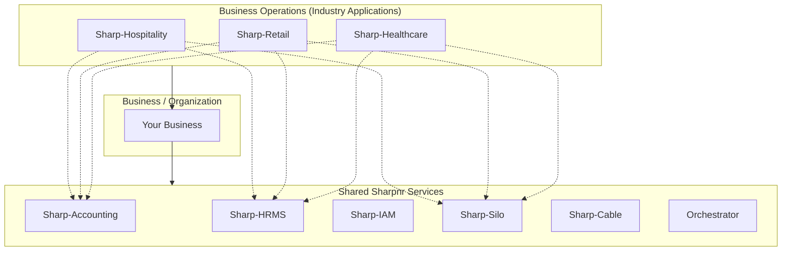

## Overview

Think of Sharpnr Suite as a collection of building blocks that help businesses run their daily operations.

A business can be anything:

- A restaurant taking orders and managing tables
- A hotel handling reservations and guests
- A retail store managing inventory and sales
- A clinic managing patients and appointments

Each type of business needs specialized software for its day-to-day operations. Sharpnr provides these industry-specific applications while also offering shared services that every business needs, such as accounting, human resources, storage, and identity management.

## A Simple Example

Imagine you own a restaurant.

You use **Sharp-Hospitality** to:

- Take customer orders
- Manage tables
- Handle reservations
- Track kitchen operations

However, running a restaurant involves more than just serving food.

You also need to:

- Pay employees
- Manage staff records
- Track revenue and expenses
- Store documents and data
- Manage user accounts and permissions

Instead of building all of these features separately inside the restaurant application, Sharp-Hospitality connects to other Sharpnr services:

- **Sharp-Accounting** manages finances.
- **Sharp-HRMS** manages employees and payroll.
- **Sharp-Silo** stores files and business data.
- **Sharp-IAM** manages users, roles, and permissions.

This allows every application in the Sharpnr ecosystem to focus on its own job while still working together when needed.

## How Sharpnr Suite Is Organized

## The Three Layers

### 1. Business Operations

This is where users spend most of their time.

These applications are designed for specific industries and workflows.

Examples:

- **Sharp-Hospitality** for restaurants, hotels, cafés, bars, and resorts.
- **Sharp-Retail** for stores, warehouses, and point-of-sale systems.
- **Sharp-Healthcare** for clinics, hospitals, and healthcare providers.

Each application solves problems unique to that industry.

### 2. Business / Organization

This represents the company itself.

Whether you run a restaurant, hotel, retail chain, or clinic, your organization has:

- Employees
- Customers
- Financial records
- Documents
- Permissions and access rules

All operational applications ultimately serve the needs of the organization.

### 3. Shared Sharpnr Services

These are the core services that support every application across the platform.

| Service          | Purpose                                          |
| ---------------- | ------------------------------------------------ |
| Sharp-Accounting | Financial management, bookkeeping, and reporting |
| Sharp-HRMS       | Employee management, payroll, and attendance     |
| Sharp-IAM        | Authentication, roles, and permissions           |
| Sharp-Silo       | Data and file storage                            |
| Sharp-Cable      | Communication and integrations                   |
| Orchestrator     | Coordinates services and workflows               |

## Independence with Integration

A key design principle of Sharpnr Suite is:

> Every application can work independently, but can also integrate with other Sharpnr services when needed.

For example:

- Sharp-Hospitality can create invoices in Sharp-Accounting.
- Sharp-Hospitality can synchronize employees with Sharp-HRMS.
- Sharp-Retail can store product images in Sharp-Silo.
- Sharp-Healthcare can use Sharp-IAM for secure staff access.

Because each service is independent, businesses can use only the components they need. As their requirements grow, additional services can be connected without replacing existing systems.

## In One Sentence

**Sharpnr Suite provides industry-specific applications for business operations, supported by a shared platform of accounting, HR, storage, identity, and integration services that work together seamlessly.**
