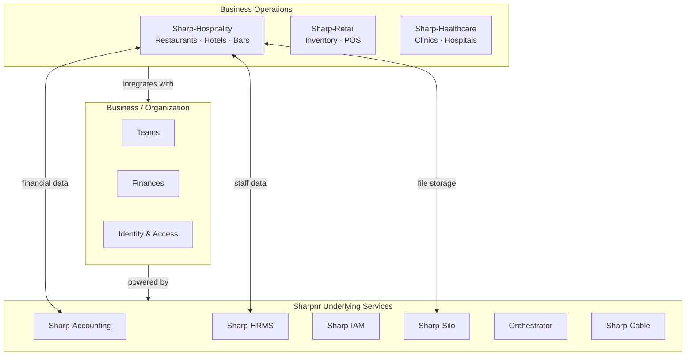

Welcome to Sharpnr, your go-to resource for all the guides and documentation you need to get started with sharpnr.

## What is Sharpnr?

Sharpnr is a platform for the business and organization for Business Operations, providing tools and resources to help you manage and optimize your operations effectively.
Sharpnr offers a wide range of cloud based services and solutions designed to streamline your business processes, enhance productivity, and drive growth.

## Architecture Overview

Sharpnr's architecture is built on a robust and scalable cloud infrastructure, ensuring high availability and performance. The platform is designed to be flexible and adaptable, allowing businesses of all sizes to leverage its capabilities effectively. Sharpnr integrates various services and tools to provide a comprehensive solution for business operations management.

// we need a mermaid diagram here to show the architecture overview
// in meraid visualize the on Top we have Business Operations, Business operation is consired the a business that need a software to manage the operations when interacting with their customers like a restaurant needs a software to manage the orders and or you can table manangement and reservation managment, etc etc, restaurant is just a one of many examples of business operations, and then below the business operations we Business/organization itself, and below that we shapnr under lying services and tools that sharpnr offers like sharp-accounting, sharp-hrms, silo(for dta storage), in Business operation sharpnr also offers a set of tools for variaty of business sectors and industries like retail, healthcare, hospitality, for hospitality we sharp-hospitality which supports restaurant, hotels, Bar Night clubs etc,
sharp-hospitality can talk to sharp-accounting to manage the financial aspect of the business, and it can also talk to sharp-hrms to manage the human resources aspect of the business, and it can also talk to silo for data storage and management, and it can also talk to other tools and services that sharpnr offers for other business sectors and industries, and all these tools and services are integrated together to provide a seamless experience for the business operations management. and operations app and services app works independently but they can also talk to each other to provide a more comprehensive solution for the business operations management.

<ArchitectureDiagram />
